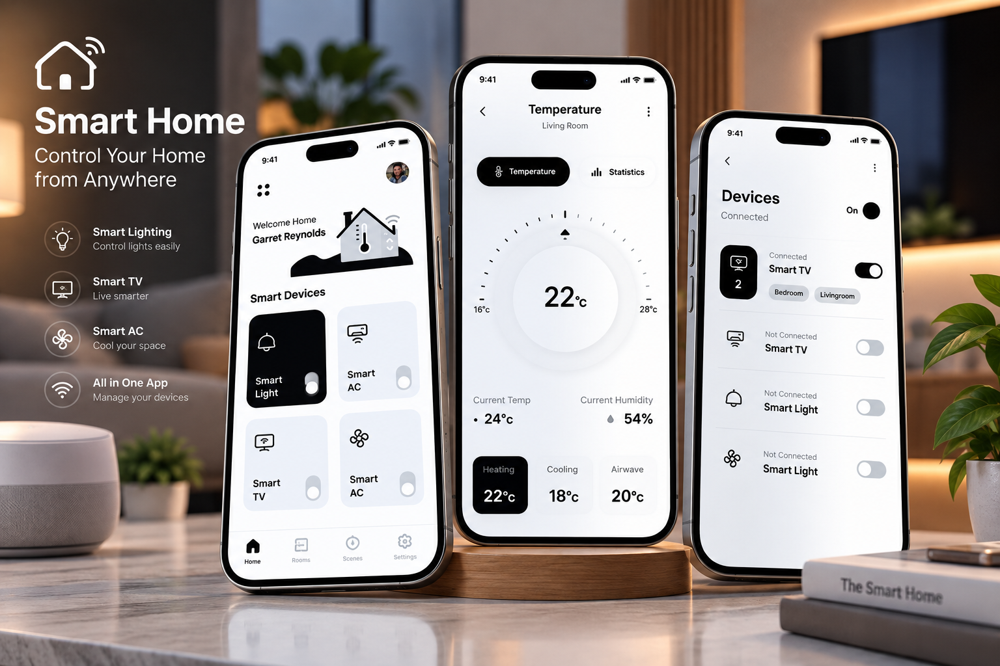

<div align="center">

# 🏠 Smart Home App Design

### Flutter • Dart • Smart Home UI • Home Automation Concept

A modern and responsive **Smart Home Application UI** built using Flutter and Dart.

Designed to showcase an intuitive smart home dashboard, connected-device controls, room organization, and a clean home automation experience.


</div>

---

## 📸 Project Preview

<div align="center">

<a href="69b7c5ff-f8b3-4b95-bd6d-5ea0eead407d.png">
  
</a>

</div>

---

## 📖 About the Project

**Smart Home App Design** is a Flutter-based application focused on creating a modern interface for smart home management.

The project explores how users can interact with home automation features through a simple, visually appealing mobile dashboard.

It demonstrates Flutter UI development, reusable widgets, responsive layouts, and interactive interface design.

**Note:** This project is presented as a UI/UX concept. Real smart-device connectivity or IoT integrations are not claimed.

---

## ✨ Key Features

### 🏠 Smart Home Dashboard

- Modern home overview interface.
- Organized smart home control panels.
- Visually appealing dashboard layout.
- Easy access to home management sections.

### 💡 Smart Device Controls

The interface is designed to represent controls for devices such as:

- Smart lighting.
- Air conditioning.
- Fans.
- Home appliances.
- Other connected devices.

### 🚪 Room Management UI

- Room-based device organization concept.
- Visual separation of home areas.
- Intuitive navigation between sections.
- Clean and structured room cards.

### 🎨 Modern UI/UX

- Clean and minimalist design.
- Custom Flutter widgets.
- Modern typography.
- Rounded cards and buttons.
- Consistent spacing and alignment.
- Responsive layout principles.
- Smooth visual interactions.

---

## 🛠️ Technologies Used

| Technology | Purpose |
|------------|---------|
| Flutter | Cross-platform UI development |
| Dart | Application logic |
| Material Design | UI components |
| Git | Version control |
| GitHub | Source code hosting |

---

## 🏗️ Application Overview

```text
              Smart Home App
                     |
                     v
              Flutter UI Layer
                     |
          +----------+----------+
          |          |          |
          v          v          v
       Dashboard    Rooms     Devices
          |          |          |
          +----------+----------+
                     |
                     v
              UI Interactions
                     |
                     v
              Visual Feedback
```

This diagram represents the application's intended UI organization rather than a verified source-code architecture.

---

## 📱 UI Components

The Smart Home interface is designed around:

| Component | Purpose |
|-----------|---------|
| Dashboard | Overview of the smart home |
| Device Cards | Represent individual devices |
| Control Switches | Show on/off control states |
| Room Sections | Organize devices by location |
| Status Indicators | Display visual device status |
| Navigation | Move between interface sections |

---

## 📂 Project Structure

The repository contains a standard Flutter project structure:

```text
Smart-Home-App-Design/
│
├── android/
├── ios/
├── lib/
├── linux/
├── macos/
├── test/
├── web/
├── windows/
│
├── .gitignore
├── .metadata
├── analysis_options.yaml
├── pubspec.yaml
├── pubspec.lock
└── README.md
```

### Main Directories

**`lib/`**

Contains the Flutter application's Dart source code.

**`android/` and `ios/`**

Platform-specific mobile project files.

**`web/`, `windows/`, `linux/`, `macos/`**

Flutter platform project files.

**`test/`**

Flutter testing directory.

---

## 🚀 Getting Started

### Prerequisites

Make sure you have installed:

- Flutter SDK
- Dart SDK
- Android Studio or VS Code
- Git
- Android emulator or physical device

### 1. Clone the Repository

```bash
git clone https://github.com/AhmedJaberAhmed/Smart-Home-App-Design.git
```

### 2. Navigate to the Project

```bash
cd Smart-Home-App-Design
```

### 3. Install Dependencies

```bash
flutter pub get
```

### 4. Check Available Devices

```bash
flutter devices
```

### 5. Run the Application

```bash
flutter run
```

### 6. Run Tests

```bash
flutter test
```

---

## 💡 Development Highlights

This project demonstrates experience in:

- Flutter UI development.
- Dart programming.
- Responsive application design.
- Building custom UI components.
- Designing smart home dashboards.
- Creating reusable widgets.
- Mobile interface navigation.
- Cross-platform Flutter project setup.

---

## 🎯 Project Goals

- Design an intuitive smart home application.
- Practice advanced Flutter UI development.
- Build reusable and visually consistent components.
- Explore home automation interface concepts.
- Improve responsive mobile layout design.

---

## 🔮 Potential Future Improvements

- 🔌 Real IoT device integration.
- 📡 MQTT communication.
- 🔥 Firebase real-time synchronization.
- 💡 Remote smart lighting controls.
- 🌡️ Temperature and climate management.
- 🎙️ Voice assistant integration.
- 📊 Energy consumption analytics.
- 🔔 Smart home notifications.
- 🔐 User authentication.
- 🌙 Dark and light themes.

---

## 👨‍💻 Developer

**Ahmed Jaber Ahmed**

Flutter Developer | Mobile App Developer

B.Sc. Computer Science & Artificial Intelligence

📍 Cairo, Egypt

- [GitHub](https://github.com/AhmedJaberAhmed)
- [Portfolio](https://ahmedjaberahmed.github.io/Jaber-website/)
- [LinkedIn](https://www.linkedin.com/in/ahmedjaberahmed/)

---

<div align="center">

### ⭐ Support the Project

If you find this project interesting, consider giving it a star!

**Built with Flutter 💙 and Dart 🎯**

</div>
